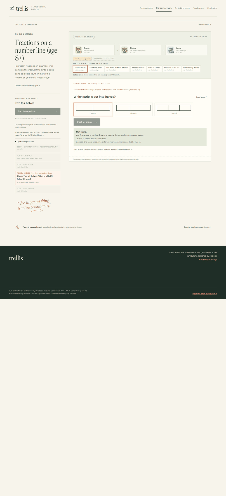
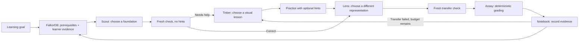
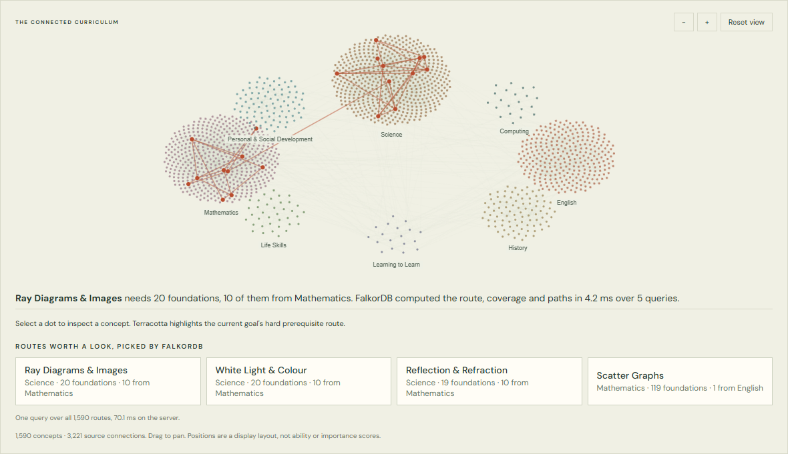
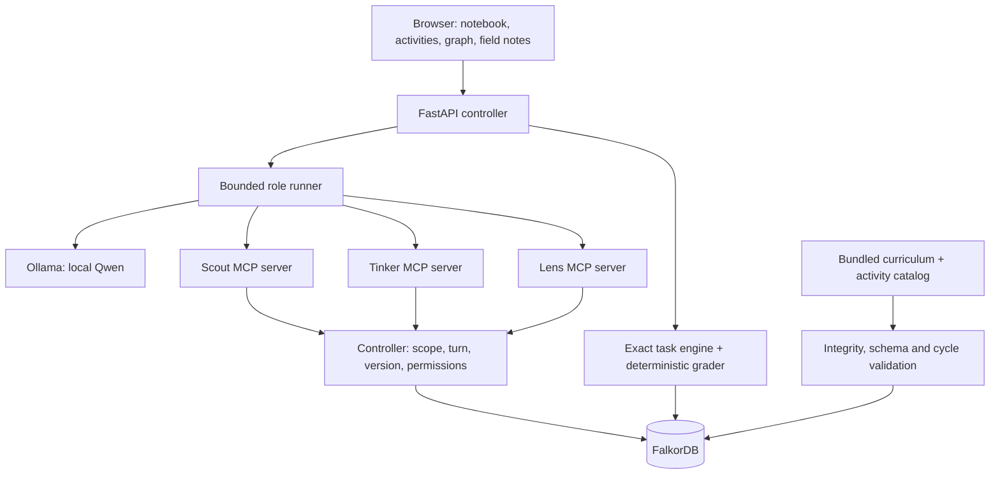
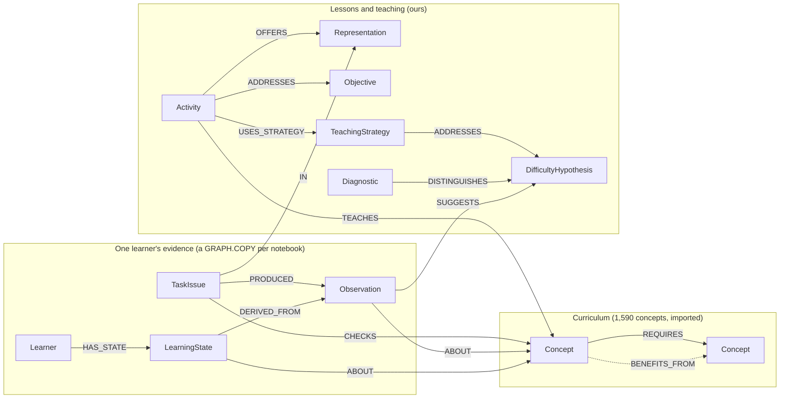

# Trellis

**A personal learning notebook that finds the missing foundation, teaches it through play, and checks whether the idea carries over.**

Three bounded tutor agents use FalkorDB to turn a child's responses into the next learning action. Explore 1,590 connected concepts; play a complete fractions expedition across seven foundations.



*Animated gallery of real browser-check screenshots in labelled policy mode. Separate captured states, not a continuous model run or a boss-fight recording.*

**Track 1: Agents That Act on Connected Data** · [Run locally](#run-locally) · [The graph decides actions](#the-graph-decides-actions) · [Evidence](#does-it-work)

## Why Trellis exists

A child can struggle with fractions on a number line because an earlier idea, such as equal parts, is uncertain. Giving them another question at the goal can miss the problem. A parent needs to know what to try next and why.

Trellis connects the goal to its prerequisites and recorded responses. It chooses a foundation to check, offers a visual lesson when needed, and asks a fresh question in a different representation. The notebook changes as evidence arrives.

The curriculum browser covers eight subjects. Interactive teaching currently covers seven fractions foundations, with five additional water diagnostics. Selecting any curriculum goal does **not** mean a complete interactive lesson exists for it.

## Try the learning loop

Open the fractions expedition from the opening panel. Its goal, **Fractions on a number line (age 8+)**, has a 14-concept route containing all seven playable lessons.

1. **Scout finds a foundation.** FalkorDB ranks eligible checks using prerequisite uncertainty, recorded difficulties and how much of the route depends on each foundation.
2. **The learner tries a fresh check.** A wrong answer leads to Tinker. A correct answer still needs a transfer check before it can satisfy the support rule.
3. **Tinker teaches.** It chooses an allowed representation and opening: strips, pies, grids, counters or number lines, with a worked example or a try-first approach. Hints are available during practice.
4. **Lens challenges understanding.** It chooses a fresh transfer task in a different representation. It never sees the answer key or task parameters.
5. **The notebook adapts.** Code grades the response, records it in FalkorDB and recomputes the route. A failed transfer leads to a different lesson; repeated difficulty leads to a pause rather than an endless loop.



### Meet the guides

| | Role | Real choice | Boundary |
|---|---|---|---|
|  | **Scout**, pathfinder | Which permitted foundation to check; whether to inspect its criteria first | Cannot teach or grade |
|  | **Tinker**, experiment guide | Whether to investigate an ambiguous mistake first, and which graph-connected teaching strategy, representation and opening to use | Cannot inspect transfer answers or declare success |
|  | **Lens**, challenger | Which eligible representation should test transfer | Cannot inspect task parameters or grade |

These are three role-specific agent contexts using the same local model, each with its own stdio MCP server and restricted tools. They are not three separately trained models. Assay and Notebook are deterministic controller code, not additional agents.

The broader curriculum also has a separate five-tool investigation guide for goals outside the fractions expedition. [Tutor runner](backend/tutor/runner.py) · [Role tool servers](backend/tutor/mcp_roles.py) · [General investigator](backend/agent.py)

## The graph decides actions

FalkorDB supplies the topology, evidence queries and ranked options from which an agent acts. The controller enforces eligibility; the model chooses within those bounds. It cannot run arbitrary Cypher, write learning evidence or override grading.

| Track 1 focus | Implemented in Trellis | Inspect it |
|---|---|---|
| Multi-hop reasoning | Traverse hard prerequisites and return a shortest witness path from goal to foundation | [Native reasoning](backend/reasoning.py) |
| Graph queries and algorithms as tools | Variable-length traversal, reverse branch coverage, shortest paths and Cypher ranking feed MCP tools | [Reasoning tests](tests/test_native_reasoning.py) |
| Tool selection through MCP | Scout can inspect before choosing; Tinker and Lens act through separate role-scoped servers | [MCP roles](backend/tutor/mcp_roles.py) |
| Actions based on connected data | Issue a check, start a lesson, select a transfer strategy, or move to another foundation as evidence changes | [Tutor controller](backend/tutor/session.py) |
| Explainable results | Witness paths, offered options, selected actions, Cypher and actual server timings appear in the UI | [Tutor UI](web/tutor.js) |

### What changes the next action?

- **Difficulty can send Scout down the prerequisite chain.** Native queries find playable foundations below the concept that caused trouble.
- **Coverage influences priority.** A foundation supporting several concepts on the route can be more useful to check than an isolated one.
- **Observed support changes the route.** The support streak joins answers to their issued tasks and representations.
- **Inference stays a hypothesis.** An unobserved foundation below an observed supported skill can move later in the checking order. It is labelled inferred and never written as observed support.
- **Lens excludes familiar representations.** Graph queries identify what the lesson offered and which representations already produced correct checks in the current run.
- **Ambiguity is resolved before teaching.** When the latest mistake in this episode is linked to an explanation node marked `ambiguous`, the controller removes the teaching options and `tinker_teach` is refused on the server until one distinguishing check has been asked. This is a controller rule, not something the model decides; Tinker still chooses which check. If no check is available (no unused item, or the one-check budget is spent) the requirement is lifted and the reason is shown. If the check is answered correctly or stays ambiguous, it is labelled inconclusive and Tinker teaches for the original mistake.
- **A strategy that did not work is not repeated.** Strategies already used in this episode are found in the graph (`TaskIssue-[:USES_STRATEGY]->TeachingStrategy` for the episode's lesson tasks), excluded from Tinker's options with the reason, and refused if requested.
- **A mistake picks the teaching strategy.** `Observation-[:SUGGESTS]->DifficultyHypothesis<-[:ADDRESSES]-TeachingStrategy` decides which strategies Tinker may use. A distinguishing check is offered only when the explanation node is marked `ambiguous`, and the issued item is chosen so its wrong answers split the open explanations.

**FalkorDB features used.** Variable-length traversal (`REQUIRES*`), `shortestPath`, Cypher ranking, `GRAPH.COPY` (one graph per notebook, plus what-if copies), unique constraints and range indexes on every written id (`GRAPH.CONSTRAINT`, inherited by each copied notebook, so duplicates are refused by the database), a full-text index with stemming for curriculum search (`db.idx.fulltext.queryNodes`), and `GRAPH.EXPLAIN`: every deciding query on *Behind the lesson* can show FalkorDB's execution plan. Only the product's own query text can be explained; arbitrary Cypher is refused.

**Agent design.** Each role sees only its own inputs and its permitted options, so a tool it should not use is not offered. Generation and judgement are separate: Tinker teaches, Lens challenges with a different representation, and code grades. The controller re-checks role, turn and state version immediately before every action, and a stale or out-of-turn call is refused rather than retried.

These tutor queries live in [graphq.py](backend/tutor/graphq.py). For example:

```cypher
// Complete hard-prerequisite closure, including the goal.
MATCH (g:Concept {id:$goal})-[:REQUIRES*0..]->(c:Concept)
RETURN DISTINCT c.id
```

```cypher
// Playable foundations below a concept with recorded difficulty.
MATCH (s:LearningState)-[:ABOUT]->(f:Concept)
WHERE f.id IN $ids AND s.status = 'needs_check' AND s.wrong > 0
MATCH path = (f)-[:REQUIRES*1..]->(p:Concept)
WHERE p.id IN $ids
MATCH (p)<-[:TEACHES]-(a:Activity {kind:'lesson'})
RETURN a.id, p.id, f.id, f.name, min(length(path)) AS steps
ORDER BY steps
```

The UI also includes the whole-curriculum constellation, a **Two learners** page (two synthetic learners slip on the same fractions foundation in different ways, so Tinker teaches one directly and investigates the other first, both answerable live), and a `GRAPH.COPY` what-if preview. A preview modifies a temporary copy, recalculates the route and deletes that copy. It does not record a learning result.



For the reasoning behind each algorithm and the alternatives considered, see [ALGORITHMS.md](ALGORITHMS.md).

## Architecture and evidence model

The frontend is plain HTML, CSS, JavaScript and SVG. FastAPI serves the application. Ollama runs Qwen locally; MCP carries tool calls; FalkorDB stores the curriculum, learner evidence and tutor decisions.



### The graph model



Read an arrow as "depends on" for `REQUIRES`: `(goal)-[:REQUIRES]->(foundation)`. The ids of concepts, activities, representations, objectives, tasks, observations, learning states and the teaching nodes have unique constraints enforced by FalkorDB, and each notebook copy inherits them.

### Where each agent decision comes from

Each agent reads the graph only through its own MCP tools; the tools run these queries ([reasoning.py](backend/reasoning.py), [graphq.py](backend/tutor/graphq.py)). The model can only pick among the options they return.

| Decision | Agent and tool | What FalkorDB computes |
|---|---|---|
| Which foundations exist behind this goal | Scout · `scout_route` | `(goal)-[:REQUIRES*0..]->(c)`: the complete multi-hop closure |
| Why a foundation matters | Scout · `scout_route` | `shortestPath((goal)-[:REQUIRES*]->(c))`: the witness path shown to the parent |
| How much of the route depends on it | Scout · `scout_route` | reverse `REQUIRES*0..` counted per candidate: route coverage |
| Where to look after a mistake | Scout · `scout_route` | `(struggled)-[:REQUIRES*1..]->(p)<-[:TEACHES]-(:Activity)`: lessons below the difficulty, nearest first |
| What can be skipped for now | Scout · `scout_route` | foundations below observed support with no observation of their own: inferred only, ranked later |
| The order Scout sees | Scout · `scout_route` | one Cypher `ORDER BY` over suspect, distance, unchecked prerequisites, inference and coverage |
| How to teach this mistake | Tinker · `tinker_handoff` | `Observation-[:SUGGESTS]->DifficultyHypothesis<-[:ADDRESSES]-TeachingStrategy<-[:USES_STRATEGY]-Activity` |
| Whether to investigate first | Controller, then Tinker · `tinker_probe` | `Observation-[:SUGGESTS]->DifficultyHypothesis {ambiguous:true}` makes a check required; `Diagnostic-[:DISTINGUISHES]->` the same node lists which checks Tinker may choose |
| What not to repeat | Tinker · `tinker_handoff` | `TaskIssue-[:USES_STRATEGY]->TeachingStrategy` for this episode's lessons: those strategies are excluded |
| Which representation tests transfer | Lens · `lens_handoff` | `Activity-[:OFFERS]->Representation`, minus representations already used by a correct check (`TaskIssue-[:IN]->Representation`) |
| Whether the idea now counts as supported | Notebook (code) | the correct-check streak since the last mistake, joined through `PRODUCED`, `ABOUT` and `IN` |

Remove the teaching links (`ADDRESSES`, `DISTINGUISHES`) and the targeted choices disappear: on the frozen cases the product rule drops from 12/12 to 0/12 and the model from 11/24 to 0/24 ([graph ablation](evidence/teaching-choice-model-no-graph-links.json)). Every query above can show FalkorDB's own execution plan on *Behind the lesson*.

Each notebook is a graph copy of the versioned public curriculum plus private synthetic evidence. Task issues, observations, parent-report history and role decisions persist in the local database volume. Copying the curriculum per learner is a demo architecture, not a measured large-scale tenancy design.

### What counts as evidence?

The fractions engine enumerates **787 distinct tasks across seven lessons**, covering equal parts, building fractions and number lines. Tasks have stable identities, are not repeated within a notebook, and use server-side answer keys with exact `fractions.Fraction` arithmetic. Worked examples are retired from checks. Exhaustion pauses the activity instead of recycling items.

**Support rule v2:** since the last incorrect check, correct unhinted checks on different items in at least two representations, including a Lens transfer and at least one answer the learner built (shading or placing a point). Lessons that only offer three-option picture questions need three such checks, so guessing is unlikely to pass. This means `supported_for_objective`, not proven mastery. Hinted practice cannot satisfy the rule. A supported objective becomes eligible for a later check after a configurable delay.

Parent reports, observed task responses and inferred hypotheses stay distinct. Reports can be revised without erasing history. Role conversations are separate; handoffs are structured records. The controller rejects stale, foreign and out-of-turn actions. Raw model explanations are unverified text and cannot establish support.

## Run locally

**Requirements:** Python 3.11+, Docker Desktop with Docker Compose, and a browser. Ollama is needed for model-driven agents; explicit policy mode works without it. Node.js is only needed for development checks and the standalone source validator.

From the cloned project directory, in PowerShell:

```powershell
python -m venv .venv
.\.venv\Scripts\python.exe -m pip install -r requirements.txt
docker compose up -d
.\.venv\Scripts\python.exe -m uvicorn backend.app:app --host 127.0.0.1 --port 8020
```

Open **http://127.0.0.1:8020**. First startup validates and imports the bundled curriculum. No separate dataset clone is needed. FalkorDB Browser is at **http://127.0.0.1:3011**; the database listens on **127.0.0.1:6384**.

For live agents, install Ollama, make sure it is running, then:

```powershell
ollama pull qwen2.5:7b
```

Choose the fractions expedition and **Start the expedition**. To try the same roles without a model, use **Run the same roles without a model**. This uses the product's mistake-aware rule (`runner.rule_choice`) through the same role servers, and is labelled rule-based, not AI. With the model, options are shown in shuffled order and every choice records whether it matches the rule.

| Setting | Default | Purpose |
|---|---|---|
| `TRELLIS_MODEL` | `qwen2.5:7b` | Installed Ollama model |
| `TRELLIS_DB_HOST` | `127.0.0.1` | FalkorDB host |
| `TRELLIS_DB_PORT` | `6384` | FalkorDB port |
| `TRELLIS_DB_TIMEOUT` | `10` seconds | Database response timeout |
| `TRELLIS_RECHECK_SECONDS` | `86400` | Delay before an objective is eligible for a later check |

Model requests go to local Ollama at `127.0.0.1:11434`; no cloud key is required. An unreachable model produces an explicit error. The pinned database image and persistent AOF volume are defined in [compose.yaml](compose.yaml). Stop the database with `docker compose stop`; avoid deleting its volume if you want to keep notebooks.

## Does it work?

These checks evaluate software behaviour on synthetic profiles. They do not measure children's learning outcomes.

| Evidence | Result and scope |
|---|---|
| [Software evaluation](evidence/evaluation.json) | **47 tests passed**: curriculum and investigation, fraction engine, tutor loop, investigation tools, the recovery workflow (required investigation, inconclusive and unavailable checks, no repeated strategy), and FalkorDB features (constraints, full-text search, EXPLAIN) |
| [Native reasoning tests](tests/test_native_reasoning.py) | All **1,590** prerequisite closures checked against an independent source-file traversal; selected coverage and shortest witnesses checked too |
| [Query benchmark](evidence/native-query-benchmark.json) | All 1,590 closures in one query: about **27 ms median server time**, seven warm local runs; largest closure 120 concepts including the goal |
| [Live tutor trace](evidence/tutor-live-loop.json) | Scout, Tinker and Lens acted through separate MCP servers using local Qwen; learner responses were scripted to exercise teaching |
| [Browser agent loop](evidence/browser-agent-loop.json) | An actual browser response triggered a fresh investigation at the new evidence revision |
| [Teaching-choice evaluation](evidence/teaching-choice-model.json) | 12 frozen synthetic cases, committed before the runs. Acceptable teaching choice: product rule **12/12**, local model **11/24** (two shuffled orders per case), always-first-option **0/12** |
| [Held-out cases](evidence/teaching-choice-heldout-v1-model.json) | 8 new cases committed before running, after offering probes only for ambiguous mistakes: rule **8/8**, model **12/16** (11/12 on specific mistakes, 1/4 on ambiguous ones), always-first-option **0/8** |
| [Graph ablation](evidence/teaching-choice-model-no-graph-links.json) | Same cases with the graph's mistake-to-strategy links deleted: rule **0/12**, model **0/24** |
| [Recovery workflow](tests/test_tutor_recovery.py) | One complete episode, tested and checked in the browser (`node ui-recovery-check.mjs`): an ambiguous placement forces a distinguishing check, the check points to counting marks, *Walk the gaps from zero* is taught, a fresh transfer still fails, and the next lesson uses a different strategy while the tried one is shown as not repeated |
| [Screenshots](evidence/screens/) | Lessons, feedback, deciding queries, parent notes, comparison and mobile layout |

**What the teaching-choice evaluation shows.** The cases and their acceptable actions were committed to the repository before these runs (see the commit history for `tests/fixtures/teaching-choice-v1.json`). The graph is what makes good choices possible: with its links between a mistake, a possible explanation and a strategy removed, every chooser fails. The model genuinely chooses (its picks fall at many positions in the shuffled list, not just the first), but it does **not** beat the simple rule: its main error was asking a distinguishing check when the mistake was already specific. An earlier run by a different setup, before the cases were committed, scored 18/24, so model results vary between runs. After that frozen run we changed one design decision: a distinguishing check is now offered only when the graph marks the mistake as ambiguous, because a specific mistake already points at its explanation. To avoid scoring a change against cases we had already seen, we wrote 8 new cases, committed them, and only then ran them: the model chose acceptably in 12 of 16 trials. It now handles specific mistakes well but still struggles to ask the distinguishing check when a placement error is ambiguous. The rule remains the stronger chooser on these cases, which is why the product exposes both modes and labels which one acted. Because of that weakness, investigating an ambiguous mistake is now **required by the controller** rather than left to the model; the model only chooses which distinguishing check to ask. Those cases therefore no longer test the model's judgement, and the evaluation results above were recorded before this change. The separate [two-goal model comparison](evidence/model-comparison.json) is a tiny investigation check, not a general model benchmark. Query timing is not end-to-end agent latency. No token-reduction or learning-effectiveness claim is made.

### Reproduce the checks

Start FalkorDB first. The evaluation creates and deletes its own synthetic learner graphs; no model is required:

```powershell
.\.venv\Scripts\python.exe -m backend.evaluate
```

This runs tests, queries dataset counts and writes a source-hash-bound report to `artifacts/evaluation.json`. Coverage includes independent answer-key checks, finite task pools, hidden answers, role permissions, different transfer representations, inferred-only support, changed recommendations, duplicate submissions, stale actions and learner isolation.

Optional checks, from the project directory:

```powershell
node vendor/os-taxonomy/scripts/validate.mjs
.\.venv\Scripts\python.exe -m backend.query_benchmark
npm ci
npm run check:ui
npm run check:tutor
node ui-investigation-check.mjs
node ui-recovery-check.mjs
```

Browser checks need the backend running and Google Chrome at the Windows path used by the scripts. They cover desktop/mobile views, the policy-mode tutor loop, answer-payload checks, query visibility and parent notes. Outputs go to `artifacts/`.

For model-driven checks, also start Ollama with the selected model available:

```powershell
.\.venv\Scripts\python.exe -m backend.tutor.live_check
.\.venv\Scripts\python.exe -m backend.tutor.choice_eval            # rule baselines, no model
.\.venv\Scripts\python.exe -m backend.tutor.choice_eval --model    # add --ablate to remove the graph links
.\.venv\Scripts\python.exe -m backend.tutor.choice_eval --model --fixture tests/fixtures/teaching-choice-heldout-v1.json
npm run check:agent
```

`live_check` rewrites `evidence/tutor-live-loop.json`. Saved evidence describes its recorded run, not an automatic guarantee about later edits.

## Inspect a run

**The learning room** shows the active role, exposed tools, permitted options and actual choice. **Behind the lesson** shows deciding Cypher, server timings, prerequisite paths and inferred-only foundations. **Field notes** shows responses, hints, difficulties, role decisions and the downloadable route.

The general investigation trace also records model identity, actual token usage and tool-result hashes. These are local inspection records, not a production monitoring service. Read-aloud uses the browser's available speech support; the text remains visible.

## Project map

| Path | Responsibility |
|---|---|
| [backend/tutor/](backend/tutor/) | Role runner, MCP tools, state machine, native evidence queries and fraction engine |
| [backend/reasoning.py](backend/reasoning.py) | Curriculum closure, coverage, shortest witnesses and ranking |
| [backend/core.py](backend/core.py), [investigation.py](backend/investigation.py) | Import, notebook graphs, reports, evidence and previews |
| [web/](web/) | Notebook UI, activity rendering, role art and graph visualization |
| [activities/](activities/) | Water diagnostics and fraction lesson mappings |
| [tests/](tests/) · [evidence/](evidence/) | Executable checks and saved reports |

Built during the hackathon with AI coding assistance. Project authors remain responsible for reviewing and understanding the implementation. The bundled curriculum data keeps its own licences and attribution: see [vendor/os-taxonomy/LICENSE](vendor/os-taxonomy/LICENSE) and [LICENSE-CONTENT](vendor/os-taxonomy/LICENSE-CONTENT).
